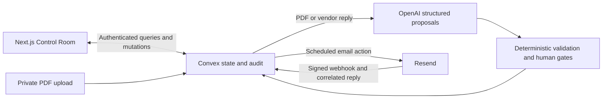

# Resolve

**Inspection software tells you what's wrong. Resolve gets it fixed.**

Inspection reports identify problems; the work to close them is scattered across email, quotes, approvals, and follow-ups. Resolve turns confirmed findings into dependency-driven remediation workflows, with a live Control Room showing what can move next and what needs a human decision.

**Resolved means proven, not reported.** In this MVP, evidence review is a human attestation. A vendor email or AI output cannot verify a repair or certify compliance.

## Core workflow

1. Upload an inspection PDF. OpenAI proposes deficiencies with source excerpts; a human edits, confirms, or rejects them.
2. Create workflows from confirmed findings. Convex computes readiness from dependencies.
3. Enable vendor coordination on an unstarted inspection workflow, choose a vendor and currency, and review the requirement. **Contact vendor** sends a real Resend email.
4. The vendor replies in that email thread. A signed webhook, conversation correlation, structured interpretation, and deterministic policy can record a quote.
5. A human approves the quote, confirms repair coordination, and attests to completion evidence.
6. Only explicit final human verification resolves the workflow. Convex updates the Control Room and audit trail in realtime.

The separate **Create demo graph** path is an explicitly simulated engine walkthrough. It sends no email and is not the inspection/vendor workflow. The public landing previews are illustrative samples.

## Architecture and integrations



| Integration | Responsibility                                                                                             | Why it fits                                                                                            |
| ----------- | ---------------------------------------------------------------------------------------------------------- | ------------------------------------------------------------------------------------------------------ |
| Convex      | Auth, private storage, transactional graph transitions, scheduled actions, audit records, reactive queries | Dependency checks, state changes, and audit events commit together; subscriptions keep the UI current. |
| OpenAI      | PDF extraction and vendor-reply interpretation through the Responses API and strict schemas                | Converts unstructured input into bounded proposals with evidence. It has no workflow execution tools.  |
| Resend      | Real outbound requests, inbound content retrieval, signed webhooks                                         | Supports reply-based coordination with message identity and replay handling.                           |
| Next.js     | Public landing page, password sign-in, inspection review, Control Room                                     | One interface for review, coordination, and human decisions.                                           |

Backend code is organized under `convex/inspections`, `convex/remediation`, and `convex/coordination`. `app/app` subscribes to authoritative Convex state; client state holds selection, loading, and form state. Convex Auth's existing Password provider protects `/app` and its children.

## Authority and security

- Authenticated identity is derived on the backend. Queries and mutations enforce ownership; clients cannot supply an actor identity or write audit events directly.
- PDF uploads use expiring, single-use capabilities, bounded streaming, and owner-checked registration. Reports are not published as storage URLs.
- Webhooks verify the raw body before accepting events. Event/provider-message deduplication and outbound idempotency limit repeated processing.
- Reply tokens and message threading must identify one conversation and the expected sender. Subject matching is not used. Sender headers alone do not prove a vendor's identity.
- Models return proposals, never permissions. Deterministic checks admit quotes; quote approval, evidence attestation, and final verification require the authenticated owner. A reported completion is only an assertion.

The live malicious-email test requested automatic approvals, skipped evidence, and resolution. The model classified it `COMPLETION_CLAIM/HIGH`, contrary to the prompt's requested `UNKNOWN/LOW`. Deterministic policy independently stored `NEEDS_REVIEW`; no workflow transition or approval resulted. This validates the observed state protection, not universal prompt-injection resistance.

## Validation

Phases 1–3 are complete. Live development validation exercised real OpenAI extraction, Resend delivery and signed replies, a $380 USD quote with Friday availability, duplicate replay, human approval, malicious-input protection, and final human resolution with realtime updates. The inspection was synthetic; no physical repair or independent attachment verification was claimed.

**100 tests across four files** cover graph invariants, ownership, uploads/review, provider contracts, email processing, and human gates. Automated provider traffic is mocked; live observations are documented separately in [PHASE2_REPORT.md](./PHASE2_REPORT.md) and [PHASE3_REPORT.md](./PHASE3_REPORT.md).

```sh
npm test
npm run typecheck
npm run lint
npm run build -- --webpack
npx tsc --noEmit -p convex/tsconfig.json
```

Use the build script: it runs the strict project typecheck before Next.js. Calling `next build` directly would skip that guard because Next's redundant internal typecheck is disabled in the existing configuration.

## Local setup

Use Node.js 22 (validated with 22.21.1) and the committed npm lockfile:

```sh
npm ci
```

For this already-configured workspace, preserve `.env.local` and its existing development deployment. Run these in separate terminals:

```sh
npx convex dev
```

```sh
npx next dev
```

Open [localhost:3000](http://localhost:3000); **Open Resolve** leads to sign-in and the Control Room.

For a fresh clone, select your own Convex development project with `npx convex dev`, then initialize its Convex Auth configuration with `npx @convex-dev/auth` and the local frontend origin. Do not overwrite an existing deployment's auth keys. The generated `NEXT_PUBLIC_CONVEX_URL` belongs in `.env.local`. See [.env.example](./.env.example) for variable names; configure provider secrets in the **Convex deployment**, not Next.js. The starter `npm run dev` also has a one-time auth setup hook; the separate commands above avoid rerunning it on this workspace.

The [synthetic sample PDF](./public/samples/resolve-sample-inspection.pdf) is available from the inspection upload page. Sign up, upload it, review the proposals, and use the existing UI workflow. AI extraction is a real paid call; expected fixture findings are not hardcoded into the extractor. Use only a mailbox you control for an email walkthrough.

## Production setup

Use a separate Convex production deployment and Vercel's Next.js hosting. The recommended first release deploys the backend explicitly, then builds Vercel with `npm run build -- --webpack` and the production `NEXT_PUBLIC_CONVEX_URL`. No backend deployment key is needed in Vercel for that manual sequence. Keep preview builds separate from production.

Convex requires `OPENAI_API_KEY`, `RESEND_API_KEY`, `RESEND_WEBHOOK_SECRET`, `RESEND_FROM_EMAIL`, `RESEND_INBOUND_DOMAIN`, `JWT_PRIVATE_KEY`, and `JWKS`. `OPENAI_EXTRACTION_MODEL` is optional. `SITE_URL` is recommended setup metadata but is not required by this password-only flow; if configured, use the public HTTPS frontend origin. Configure the production Convex `/resend-webhook` endpoint in Resend, and use a verified sender for general recipients. Development users, conversations, files, and graphs are not copied automatically.

The [production readiness report](./PRODUCTION_READINESS_REPORT.md) contains the environment matrix, remaining blockers, Git initialization instructions, and ordered deployment plan. Production deployment and external setup have **not** been performed.

## Current limitations

- Evidence and final verification are human attestations; there are no repair-evidence uploads, payments, purchase orders, or compliance certification.
- Plain-text email parsing is heuristic. HTML-only, oversized, ambiguous, or instruction-like replies need review; attachments are metadata only. Friday remains availability text, not a scheduled date.
- Model confidence is not calibrated, and extraction quality was exercised on a synthetic report. Provider billing was not measured. `store: false` is not a promise of zero provider retention.
- Capacity is bounded: 10 MiB PDFs, 40 findings per report, 100 reports/graphs/vendors per owner, 100 nodes and 300 edges per graph, and 100 communications per graph. There is no large-scale pagination or general workflow editor.
- Password signup is open; email verification/reset and application-wide paid-action quotas are not configured. Per-owner limits do not prevent abuse across accounts. Public unattended use requires an operator decision on access and spend controls.
- Delivery was verified in the actual mailbox; the live test did not establish delivery-webhook progression in the app. Operational monitoring, retention, and production recovery remain limited.
